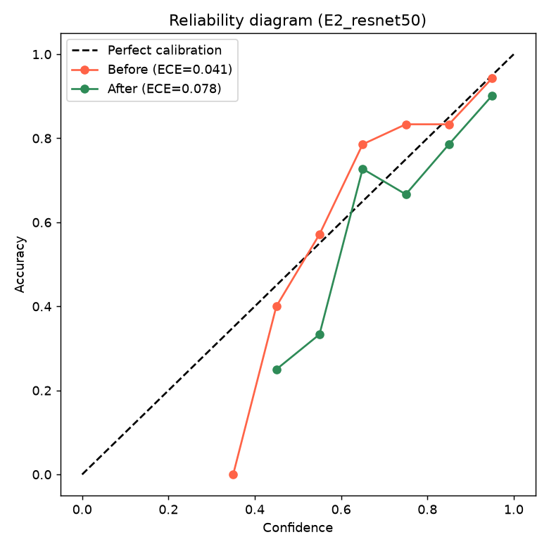
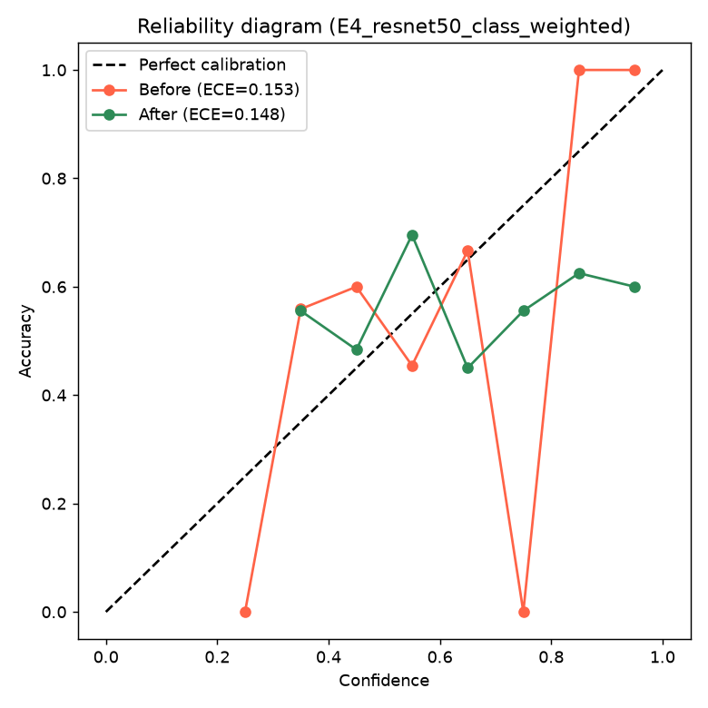
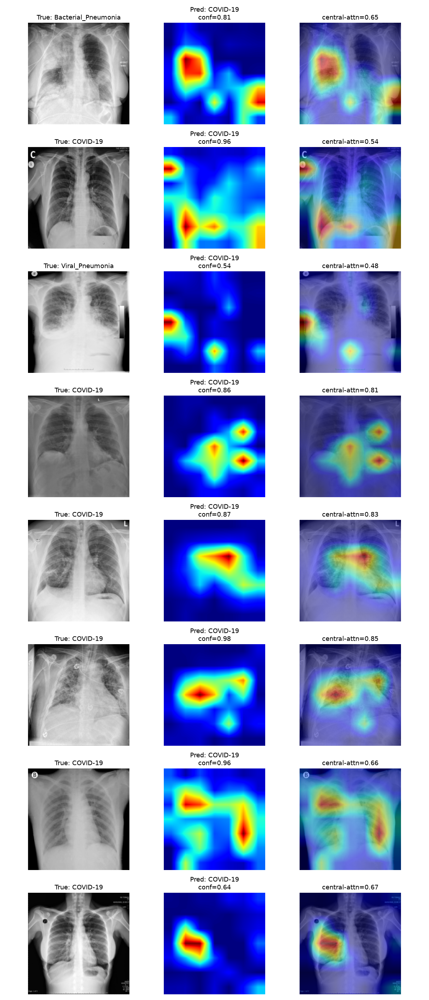

# COVID-19 and Other Pneumonia Etiology Classification in Chest X-ray: A Comparative Analysis

This report presents research findings and technical evaluation results, not a clinical diagnostic tool. Model predictions must not be used independently for diagnosis, screening, or treatment decisions. Image interpretation requires assessment by a physician or radiologist together with the relevant clinical context.

## 1. E1. Data Audit and Leakage Prevention

**Objective.** Understand data characteristics, detect duplication, and ensure leakage-free splits.

**Method.** Manifest built from metadata; labels normalized to four etiology classes; md5 for exact duplicates; difference-hash (Hamming<=2) for near-duplicates; union-find grouping; stratified per-patient split (not per-image).

### Results

| Class | Count |
| --- | --- |
| COVID-19 | 504 |
| Bacterial_Pneumonia | 73 |
| Viral_Pneumonia | 42 |
| Fungal_Pneumonia | 32 |

Summary: {"total_metadata_rows": 950, "modality_filter": ["X-ray"], "valid_image_files": 848, "missing_files": 0, "excluded_buckets": {"Excluded_Unlabeled": 84, "Excluded_ARDS_Unspecified": 81, "Excluded_Other": 32}, "images_in_scope": 651, "unique_patients": 362, "class_distribution": {"COVID-19": 504, "Bacterial_Pneumonia": 73, "Viral_Pneumonia": 42, "Fungal_Pneumonia": 32}, "imbalance_ratio_max_min": 15.75, "readable_images": 651, "exact_duplicate_rows": 0, "near_duplicate_pairs": 41, "cross_patient_near_duplicate_pairs": 35, "unique_dedup_groups": 342, "patient_leakage_clean": true, "dedup_group_leakage_clean": true, "split_counts": {"train": 447, "test": 105, "val": 99}, "width_median": 1024.0, "height_median": 967.0, "mean_intensity_range": [46.58049774169922, 216.57003784179688]}

### Description

The in-scope dataset contains 651 X-ray images from 362 patients and 342 dedup groups. Class distribution is imbalanced: COVID-19=504, Bacterial_Pneumonia=73, Viral_Pneumonia=42, Fungal_Pneumonia=32 (majority:minority ratio = 15.75:1). No exact (md5) duplicates were found, but 41 near-duplicate pairs (Hamming<=2) were detected, 35 of them cross-patient. Patient-level splitting produced train=447, val=99, test=105; both patient and dedup-group leakage checks passed.

### Interpretation

Description: The audit summarizes data completeness, data split composition, and identified anomalies. Results: 651 samples recorded; 0 missing labels or data records; 41 duplicates identified. Interpretation: These statistics describe the available data, not diagnostic quality or population representativeness. Implication: Group data at the patient level before splitting, document data cleaning, and report per-class metrics together with sample counts. Limitations: A tabular audit does not verify label accuracy, image quality, patient independence, or distributional equivalence to the clinical population.

### Implication

Four etiology classes are used for modeling; invalid and ambiguous categories (unspecified ARDS, Lipoid, TB, Aspiration) are excluded. The imbalance experiment (E4) becomes highly relevant.

### Limitations

Most images come from published COVID-19 case reports, introducing selection bias and possible source differences across classes. dHash is heuristic; heavily edited near-duplicates may go undetected.

## 2. E2-E4. Baseline, Transfer Learning, and Class-Imbalance Handling

**Objective.** Compare a baseline CNN against transfer learning and test imbalance strategies.

**Method.** Baseline: SmallCNN trained from scratch. Transfer learning: ResNet50/EfficientNet-B0/DenseNet121 pretrained on ImageNet, backbone frozen then top blocks fine-tuned. Imbalance: none / class-weighted loss / weighted random sampler. Model selection uses validation macro F1; final evaluation on the test set.

### Results

| Experiment | Model | Imbalance | Val_F1 | Acc | Bal_Acc | Test_MacroF1 | ROC_AUC |
| --- | --- | --- | --- | --- | --- | --- | --- |
| E2_resnet50 | resnet50 | none | 0.5429 | 0.8000 | 0.3773 | 0.4100 | 0.7548 |
| E3_efficientnet_b0 | efficientnet_b0 | none | 0.4781 | 0.7905 | 0.3667 | 0.4037 | 0.7344 |
| E4_resnet50_class_weighted | resnet50 | class_weighted | 0.4140 | 0.5524 | 0.4430 | 0.3864 | 0.6854 |
| E4_resnet50_weighted_sampler | resnet50 | weighted_sampler | 0.4170 | 0.6857 | 0.3995 | 0.3781 | 0.7186 |
| E3_densenet121 | densenet121 | none | 0.3520 | 0.7905 | 0.3273 | 0.3451 | 0.7276 |
| E2_baseline_cnn | small_cnn | none | 0.2541 | 0.7619 | 0.2410 | 0.2162 | 0.6277 |

### Description

6 experiments were run with identical splits and metrics. The best test-set model is E2_resnet50 (macro F1=0.4100, balanced acc=0.3773, acc=0.8000). The weakest is E2_baseline_cnn (macro F1=0.2162). The highest `macro_f1` value is 0.4100 for resnet50. The difference from the next-highest value (efficientnet_b0, 0.4037) is 0.0063 points. The range is 0.1938 points, from 0.2162 for small_cnn to 0.4100. These differences are descriptive comparisons and do not establish stable superiority or statistical significance.

### Interpretation

Description: The experiments compare architecture configurations using `macro_f1` under the same evaluation. Results: The highest `macro_f1` value is 0.4100 for resnet50. The difference from the next-highest value (efficientnet_b0, 0.4037) is 0.0063 points. The range is 0.1938 points, from 0.2162 for small_cnn to 0.4100. These differences are descriptive comparisons and do not establish stable superiority or statistical significance. Interpretation: Higher scores indicate better results on this evaluation data, but small differences may arise from training variation or sample composition. Implication: Select candidates by considering per-class performance, computational cost, and revalidation; do not select solely on the basis of one aggregate score. Limitations: The comparison does not automatically control for seeds, number of epochs, augmentation, or data leakage; significance testing and external evaluation cannot be inferred from this table.

### Implication

E2_resnet50 is selected for downstream analysis because it has the highest macro F1 on the validation set, *not* because it is clinically preferable: the headline metrics here reward majority-class behaviour (see 'Key finding' below).

### Limitations

Epochs are limited because training runs on CPU without a GPU; results indicate relative trends, not maximal performance. The small test set means small differences between models should be read alongside confidence intervals.

## 3. Key Finding: High Accuracy Can Hide a Useless Classifier

**Objective.** Check whether the headline accuracy reflects genuine four-class discrimination.

**Method.** Count how often each model predicts each class on the test set, and compare with the true class counts (COVID-19 83, Bacterial 11, Fungal 6, Viral 5).

### Results

| Experiment | Accuracy | Predicted_per_class | Majority_share_of_predictions |
| --- | --- | --- | --- |
| E2_baseline_cnn | 0.7619 | 3 / 102 / 0 / 0 | 0.9714 |
| E2_resnet50 | 0.8000 | 1 / 99 / 2 / 3 | 0.9429 |
| E3_densenet121 | 0.7905 | 2 / 101 / 2 / 0 | 0.9619 |
| E3_efficientnet_b0 | 0.7905 | 7 / 94 / 2 / 2 | 0.8952 |
| E4_resnet50_class_weighted | 0.5524 | 26 / 60 / 11 / 8 | 0.5714 |
| E4_resnet50_weighted_sampler | 0.6857 | 8 / 83 / 9 / 5 | 0.7905 |

### Description

The test set is dominated by COVID-19 (83 of 105 images). E2_baseline_cnn sends 97% of all predictions to a single class while reporting accuracy 0.7619. The class-weighted model spreads predictions across all four classes, which is why it looks 'worse' on accuracy but is the only model that detects non-COVID pneumonia at all.

### Interpretation

Accuracy and macro F1 computed on a heavily imbalanced test set can reward a model that has learned the base rate instead of the task. For a screening application a false negative on COVID-19 is more costly than a false positive, so per-class sensitivity, not overall accuracy, must drive model selection.

### Implication

Report per-class sensitivity and balanced accuracy alongside accuracy, and never select a model on the test set. The class-imbalance strategy is not an optional extra but the central modelling decision.

### Limitations

Each of the three minority classes has 5-11 test images, so per-class estimates carry very wide uncertainty; this analysis demonstrates a failure mode rather than estimating its exact size.

## 4. E5. Center-Crop Ablation

**Objective.** Test whether predictions depend on image borders or on the central (thoracic) region.

**Method.** Re-evaluate the test set with center-crop fractions 1.0/0.8/0.6, then resize back to 224 px; applied to two models selected a priori (the class-weighted ResNet50 and the unweighted ResNet50).

### Results

| Experiment | macroF1_crop_0.6 | macroF1_crop_0.8 | macroF1_crop_1.0 |
| --- | --- | --- | --- |
| E2_resnet50 | 0.3574 | 0.4300 | 0.4100 |
| E4_resnet50_class_weighted | 0.2666 | 0.4472 | 0.3864 |

### Description

E2_resnet50: crop=1.0 -> macro F1=0.4100 (balanced acc=0.3773), crop=0.8 -> macro F1=0.4300 (balanced acc=0.4326), crop=0.6 -> macro F1=0.3574 (balanced acc=0.3547); E4_resnet50_class_weighted: crop=1.0 -> macro F1=0.3864 (balanced acc=0.4430), crop=0.8 -> macro F1=0.4472 (balanced acc=0.5975), crop=0.6 -> macro F1=0.2666 (balanced acc=0.3645).

### Interpretation

Both models behave non-monotonically. A mild crop to 0.8 *helps*: E4_resnet50_class_weighted gains 0.0608 macro F1, and the class-weighted model's balanced accuracy rises from 0.44 to 0.60. Cropping further to 0.6 then sharply hurts both (roughly 0.12-0.13 macro F1 below clean), so the models neither ignore the thorax nor rely on it exclusively. Two readings are consistent with this: borders carry uninformative clutter (frames, markers) worth removing, and a 0.6 crop begins to discard lung field itself. The data therefore support mild center-cropping as preprocessing, not aggressive cropping.

### Implication

If a moderate center-crop is harmless or beneficial, border artifacts can be discarded before training and inference.

### Limitations

Center-crop is not true lung segmentation; the central region is only a coarse proxy for the thorax.

## 5. E6. Robustness Testing

**Objective.** Measure model resilience to image-quality degradation.

**Method.** Corrupt the test set with Gaussian noise, brightness, contrast, Gaussian blur, and downscaling at several severity levels; measure macro F1 and accuracy. The corruption pipeline now uses the same resize as evaluation, so the 'none' row is an exact clean baseline.

### Results

| Experiment | none_0.0 | gaussian_noise_0.02 | gaussian_noise_0.05 | gaussian_noise_0.1 | brightness_0.7 | brightness_1.3 | contrast_0.7 | contrast_1.3 | gaussian_blur_1.0 | gaussian_blur_2.0 | downscale_0.5 | downscale_0.25 |
| --- | --- | --- | --- | --- | --- | --- | --- | --- | --- | --- | --- | --- |
| E2_resnet50 | 0.4100 | 0.2207 | 0.2207 | 0.2207 | 0.4158 | 0.4097 | 0.4599 | 0.4035 | 0.3478 | 0.2194 | 0.3451 | 0.2204 |
| E4_resnet50_class_weighted | 0.3864 | 0.2177 | 0.2158 | 0.2127 | 0.4002 | 0.2590 | 0.4467 | 0.3478 | 0.2854 | 0.2138 | 0.2359 | 0.3515 |

### Description

E2_resnet50: clean macro F1=0.4100, largest drop under gaussian_blur (severity=2.0) to 0.2194 (down 0.1906); E4_resnet50_class_weighted: clean macro F1=0.3864, largest drop under gaussian_noise (severity=0.1) to 0.2127 (down 0.1737).

### Interpretation

Gaussian noise is the most damaging corruption for both models, and blur plus strong downscaling follow closely. The decisive observation is the divergence between accuracy and macro F1 under noise: the unweighted model holds its accuracy near 0.79 across all noise levels while macro F1 and balanced accuracy both collapse to about half their clean value. The model has not become confused; it has retreated entirely to the majority class. A robustness report based on accuracy alone would have declared this model robust to noise, which is exactly the trap this experiment is designed to expose. The class-weighted model degrades more gracefully but still loses over 40% of its macro F1.

### Implication

Noise and blur dominate the degradation, so they are the priority for augmentation and for inference-time quality control.

### Limitations

Corruptions are synthetic and do not fully represent real clinical artifacts; some severity grids (e.g. downscaling) are not monotone because of the small test set.

## 6. E8. Confidence Calibration and Selective Prediction

**Objective.** Assess whether model confidence matches accuracy and build an abstention mechanism.

**Method.** Expected Calibration Error (ECE) and reliability diagram; single-parameter temperature scaling fitted on the validation set (log-parameterisation for numerical stability); selective prediction across confidence thresholds.

### Results

| Experiment | ECE_before | ECE_after | Temperature | Mean_confidence | Accuracy | Overconfidence_gap |
| --- | --- | --- | --- | --- | --- | --- |
| E2_resnet50 | 0.0415 | 0.0776 | 0.7100 | 0.7854 | 0.8000 | -0.0146 |
| E4_resnet50_class_weighted | 0.1528 | 0.1478 | 0.6598 | 0.4864 | 0.5524 | -0.0659 |

**Selective prediction**

| threshold | coverage | selective_accuracy | n_kept | Experiment |
| --- | --- | --- | --- | --- |
| 0.3000 | 1.0000 | 0.8000 | 105 | E2_resnet50 |
| 0.4000 | 1.0000 | 0.8000 | 105 | E2_resnet50 |
| 0.5000 | 0.9619 | 0.8218 | 101 | E2_resnet50 |
| 0.6000 | 0.9333 | 0.8367 | 98 | E2_resnet50 |
| 0.7000 | 0.8286 | 0.8506 | 87 | E2_resnet50 |
| 0.8000 | 0.7143 | 0.8800 | 75 | E2_resnet50 |
| 0.9000 | 0.5810 | 0.9016 | 61 | E2_resnet50 |
| 0.3000 | 1.0000 | 0.5524 | 105 | E4_resnet50_class_weighted |
| 0.4000 | 0.9143 | 0.5521 | 96 | E4_resnet50_class_weighted |
| 0.5000 | 0.6190 | 0.5846 | 65 | E4_resnet50_class_weighted |
| 0.6000 | 0.4000 | 0.5238 | 42 | E4_resnet50_class_weighted |
| 0.7000 | 0.2095 | 0.5909 | 22 | E4_resnet50_class_weighted |
| 0.8000 | 0.1238 | 0.6154 | 13 | E4_resnet50_class_weighted |
| 0.9000 | 0.0476 | 0.6000 | 5 | E4_resnet50_class_weighted |

### Description

E2_resnet50: ECE 0.0415 -> 0.0776 (T=0.710), confidence=0.7854 vs accuracy=0.8000; E4_resnet50_class_weighted: ECE 0.1528 -> 0.1478 (T=0.660), confidence=0.4864 vs accuracy=0.5524.

### Interpretation

Temperature scaling is fitted on validation and applied to test, so it cannot change accuracy; it only redistributes confidence. Both models are slightly *underconfident* on average (negative gap), but ECE treats miscalibration in either direction as error. For the class-weighted model scaling helps a little (ECE 0.153 -> 0.148) because its confidence is spread across bins. For the unweighted model ECE gets *worse* (0.042 -> 0.078): its confidence is already concentrated near the prediction threshold of a single class, and T<1 sharpens that further. The lesson is that a low ECE can coexist with poor discrimination, and calibration cannot repair a model that ignores most classes. Selective prediction behaves differently per model: for the unweighted model accuracy climbs from 0.80 at full coverage to 0.90 at ~58% coverage, but this filters mostly on COVID-vs-other confidence, so the accepted set stays dominated by the majority class. For the class-weighted model accuracy never exceeds ~0.62 at any threshold, so there is no useful operating point.

### Implication

A threshold can flag uncertain predictions as 'review required' for research purposes; it does not remedy a model that ignores three of the four classes.

### Limitations

Calibration is fitted on a small validation set (n=99); ECE is sensitive to bin count and sample size, and with 105 test images a single image moves accuracy by ~1 point.

## 7. E7. Explainability with Grad-CAM

**Objective.** Inspect the image regions driving model predictions.

**Method.** Grad-CAM on the last convolutional block over 8 randomly sampled test images per model; heatmap overlay; fraction of activation energy in the central region as a quantitative focus indicator.

### Results

| filename | true | pred | confidence | central_attention_fraction | Experiment |
| --- | --- | --- | --- | --- | --- |
| bdc40f9ad2395d88c92479089f5d1b_jumbo-10.jpeg | Bacterial_Pneumonia | COVID-19 | 0.8080 | 0.6450 | E2_resnet50 |
| tpmd200203f2-c.png | COVID-19 | COVID-19 | 0.9610 | 0.5370 | E2_resnet50 |
| 000001-4.jpg | Viral_Pneumonia | COVID-19 | 0.5390 | 0.4820 | E2_resnet50 |
| 5782ae15.jpg | COVID-19 | COVID-19 | 0.8580 | 0.8100 | E2_resnet50 |
| 16953_4_1.jpg | COVID-19 | COVID-19 | 0.8710 | 0.8270 | E2_resnet50 |
| covid-19-pneumonia-progression-and-regression-day13.jpg | COVID-19 | COVID-19 | 0.9820 | 0.8490 | E2_resnet50 |
| gr1_lrg-b.jpg | COVID-19 | COVID-19 | 0.9590 | 0.6640 | E2_resnet50 |
| covid-19-caso-95-1-15.png | COVID-19 | COVID-19 | 0.6400 | 0.6730 | E2_resnet50 |
| bdc40f9ad2395d88c92479089f5d1b_jumbo-10.jpeg | Bacterial_Pneumonia | COVID-19 | 0.4280 | 0.7190 | E4_resnet50_class_weighted |
| tpmd200203f2-c.png | COVID-19 | COVID-19 | 0.6000 | 0.4940 | E4_resnet50_class_weighted |
| 000001-4.jpg | Viral_Pneumonia | Viral_Pneumonia | 0.3820 | 0.9430 | E4_resnet50_class_weighted |
| 5782ae15.jpg | COVID-19 | COVID-19 | 0.3830 | 0.7720 | E4_resnet50_class_weighted |
| 16953_4_1.jpg | COVID-19 | Bacterial_Pneumonia | 0.6930 | 0.9320 | E4_resnet50_class_weighted |
| covid-19-pneumonia-progression-and-regression-day13.jpg | COVID-19 | COVID-19 | 0.6810 | 0.8850 | E4_resnet50_class_weighted |
| gr1_lrg-b.jpg | COVID-19 | COVID-19 | 0.5300 | 0.7180 | E4_resnet50_class_weighted |
| covid-19-caso-95-1-15.png | COVID-19 | Bacterial_Pneumonia | 0.3880 | 0.9390 | E4_resnet50_class_weighted |

### Description

E2_resnet50: mean central-attention fraction=0.686 (75% of the shown samples correct); E4_resnet50_class_weighted: mean central-attention fraction=0.800 (62% of the shown samples correct).

### Interpretation

High central-region energy indicates the model looks at the thorax rather than at markers or text, so the class-weighted model's predictions are not obviously driven by source artifacts. Grad-CAM is indicative, not causal: a heatmap inside the lungs does not prove the model uses the correct radiological findings.

### Implication

The finding supports using center-crop as a light artifact-removal step and flags the shortcut-learning risk that must be checked with an external dataset.

### Limitations

The central region is a coarse proxy because lung masks are unavailable; Grad-CAM is low-resolution and only 8 images per model are shown.

## 8. Statistical Evaluation: Bootstrap Confidence Intervals

**Objective.** Quantify uncertainty in the primary test-set metrics across the compared models.

**Method.** Percentile bootstrap resampling of the test set predictions; 95% intervals for macro F1 and balanced accuracy.

### Results

| Experiment | macro_f1_mean | macro_f1_CI | balanced_accuracy_mean | balanced_accuracy_CI |
| --- | --- | --- | --- | --- |
| E2_resnet50 | 0.3976 | [0.2251, 0.5568] | 0.3805 | [0.2471, 0.5417] |
| E3_efficientnet_b0 | 0.3937 | [0.2396, 0.5238] | 0.3693 | [0.2506, 0.5060] |
| E4_resnet50_class_weighted | 0.3795 | [0.2591, 0.4956] | 0.4454 | [0.2806, 0.6079] |

### Description

Percentile bootstrap with 1000 resamples on the test set (n=105). The macro-F1 and balanced-accuracy intervals of all three models overlap almost completely.

### Interpretation

Because the intervals overlap, the observed ranking of models on this test set is not statistically separable; the differences are within sampling noise. The honest conclusion is that the experiment cannot rank these architectures reliably, which is why the design-level finding (class dominance) is the more defensible result.

### Implication

CIs are reported so that performance differences are not overstated.

### Limitations

Image-level bootstrap ignores correlation between images from the same patient; the intervals are therefore slightly optimistic.

---

**Clinical disclaimer:** This report presents research findings and technical evaluation results, not a clinical diagnostic tool. Model predictions must not be used independently for diagnosis, screening, or treatment decisions. Image interpretation requires assessment by a physician or radiologist together with the relevant clinical context.
