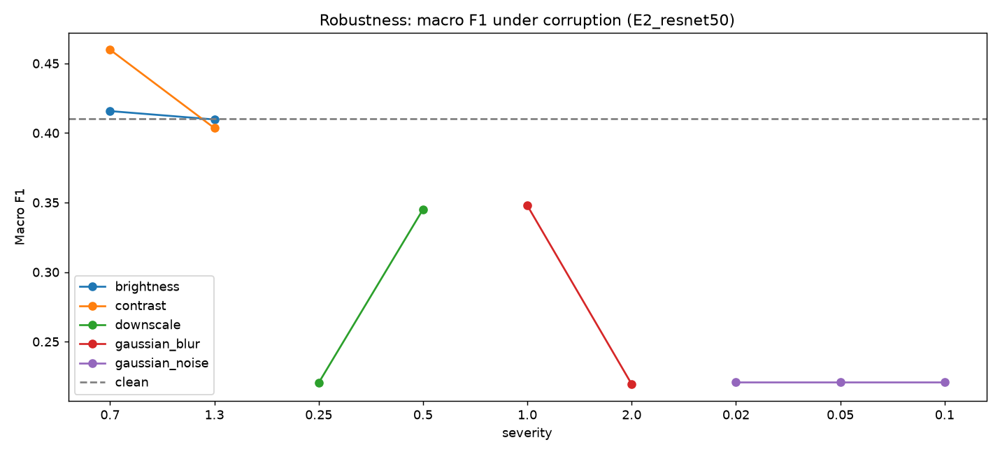
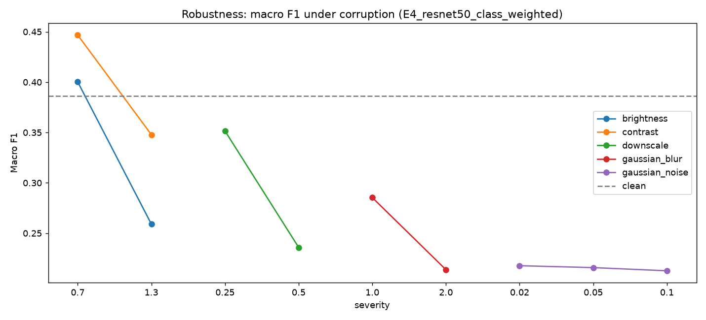
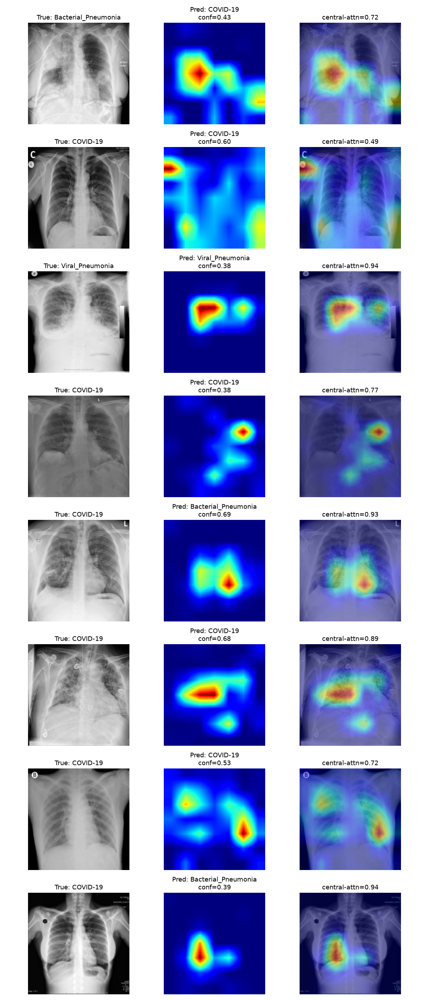

# COVID-19 and Other Pneumonia Etiology Classification in Chest X-ray: A Comparative Analysis

This report presents research findings and technical evaluation results, not a clinical diagnostic tool. Model predictions must not be used independently for diagnosis, screening, or treatment decisions. Image interpretation requires assessment by a physician or radiologist together with the relevant clinical context.

## 1. E1. Data Audit and Leakage Prevention

**Objective.** Understand the data, detect duplication, and build splits that cannot leak.

**Method.** A manifest is built from the dataset metadata and labels are normalised into four etiology classes. Exact duplicates are found by md5 hash and near-duplicates by difference hash with a Hamming distance of at most 2. Both are merged into groups with union-find. The split is stratified and applied per patient group rather than per image.

### Results

| Class | Count |
| --- | --- |
| COVID-19 | 504 |
| Bacterial_Pneumonia | 73 |
| Viral_Pneumonia | 42 |
| Fungal_Pneumonia | 32 |

### Description

The audit covers 651 X-ray images from 362 patients, which collapse into 342 deduplication groups. The classes are heavily unbalanced: COVID-19 contributes 504 images while Fungal_Pneumonia contributes only 32, a ratio of 15.75 to 1. No exact duplicate was found, so the same file never appears twice. Near-duplicate analysis is less reassuring: 41 pairs are perceptually almost identical, and 35 of them carry different patient IDs. The final split holds 447 training, 99 validation and 105 test images, and both the patient-level and the deduplication-group leakage checks pass.

### Interpretation

The imbalance is the single most consequential property of this dataset. Because COVID-19 alone accounts for 77% of the images, a model can reach a high accuracy by answering the same class every time, so accuracy cannot be trusted as a summary metric here. Macro F1 and balanced accuracy are reported instead. The 35 cross-patient near-duplicate pairs matter for a different reason. They mean the same radiograph reached the dataset twice under different identifiers, and without grouping it would land in both the training and the test split, quietly inflating the score. Grouping by near-duplicate first is what prevents that.

### Limitations

Most images come from published COVID-19 case reports, which introduces selection bias and possible source differences between classes. The difference hash is a heuristic, so heavily edited near-duplicates may still pass undetected.

## 2. E2-E4. Baseline, Transfer Learning, and Class-Imbalance Handling

**Objective.** Compare a baseline CNN against transfer learning and test two ways of handling class imbalance.

**Method.** The baseline is a small CNN trained from scratch. The transfer models are ResNet50, EfficientNet-B0 and DenseNet121 pretrained on ImageNet, with the backbone frozen and then the top blocks fine-tuned. Imbalance is addressed either through a class-weighted loss or a weighted random sampler, and one run uses no correction at all. The model is chosen on validation macro F1 and only then evaluated once on the test set.

### Results

| Experiment | Model | Imbalance | Val_F1 | Acc | Bal_Acc | Test_MacroF1 | ROC_AUC |
| --- | --- | --- | --- | --- | --- | --- | --- |
| E2_resnet50 | resnet50 | none | 0.5429 | 0.8000 | 0.3773 | 0.4100 | 0.7548 |
| E3_efficientnet_b0 | efficientnet_b0 | none | 0.4781 | 0.7905 | 0.3667 | 0.4037 | 0.7344 |
| E4_resnet50_class_weighted | resnet50 | class_weighted | 0.4140 | 0.5524 | 0.4430 | 0.3864 | 0.6854 |
| E4_resnet50_weighted_sampler | resnet50 | weighted_sampler | 0.4170 | 0.6857 | 0.3995 | 0.3781 | 0.7186 |
| E3_densenet121 | densenet121 | none | 0.3520 | 0.7905 | 0.3273 | 0.3451 | 0.7276 |
| E2_baseline_cnn | small_cnn | none | 0.2541 | 0.7619 | 0.2410 | 0.2162 | 0.6277 |

### Description

Six configurations were trained on the same splits and scored on the same test set. E2_resnet50 reaches the highest test macro F1 at 0.410, followed closely by E3_efficientnet_b0, while E2_baseline_cnn trails at 0.216. The spread between the best and the worst model is 0.194. The same ranking does not hold for balanced accuracy. The class-weighted model sits near the bottom of the macro-F1 column at 0.386, yet it leads on balanced accuracy at 0.443. Reading the two metrics together is what makes the trade-off visible.

### Interpretation

Transfer learning clearly beats the model trained from scratch, so pretrained features carry real signal even when the domain is grayscale radiography. Among the pretrained backbones the differences are small: ResNet50, EfficientNet-B0 and the weighted-sampler variant all land within roughly 0.03 macro F1 of each other, which is below the sampling noise of a 105-image test set. The more meaningful contrast runs along the imbalance axis. Rebalancing the loss lowers macro F1 and accuracy but lifts balanced accuracy, because it stops the model from collapsing onto the majority class. Section 3 shows exactly how large that collapse is.

### Limitations

Training runs on CPU without a GPU, so the number of epochs is deliberately small and the absolute scores are indicative rather than competitive. Each configuration was trained with a single seed, and the test set is small enough that small gaps should be read together with the confidence intervals in the last section.

## 3. Key Finding: High Accuracy Can Hide a Useless Classifier

**Objective.** Check whether the headline accuracy reflects genuine four-class discrimination.

**Method.** For every trained model, count how often each class is predicted on the test set and compare the counts with the true composition (83 COVID-19 images out of 105). Per-class recall is then computed for the two models that receive the detailed analysis.

### Results

| Experiment | Accuracy | Predicted counts (Bact / COVID / Fung / Viral) | Share of predictions on one class |
| --- | --- | --- | --- |
| E2_baseline_cnn | 0.7620 | 3 / 102 / 0 / 0 | 0.9710 |
| E2_resnet50 | 0.8000 | 1 / 99 / 2 / 3 | 0.9430 |
| E3_densenet121 | 0.7900 | 2 / 101 / 2 / 0 | 0.9620 |
| E3_efficientnet_b0 | 0.7900 | 7 / 94 / 2 / 2 | 0.8950 |
| E4_resnet50_class_weighted | 0.5520 | 26 / 60 / 11 / 8 | 0.5710 |
| E4_resnet50_weighted_sampler | 0.6860 | 8 / 83 / 9 / 5 | 0.7900 |

**Recall per class**

| Experiment | Bacterial_Pneumonia | COVID-19 | Fungal_Pneumonia | Viral_Pneumonia |
| --- | --- | --- | --- | --- |
| E2_baseline_cnn | 0.0000 | 0.9600 | 0.0000 | 0.0000 |
| E2_resnet50 | 0.0000 | 0.9800 | 0.3300 | 0.2000 |
| E3_densenet121 | 0.0000 | 0.9800 | 0.3300 | 0.0000 |
| E3_efficientnet_b0 | 0.1800 | 0.9500 | 0.3300 | 0.0000 |
| E4_resnet50_class_weighted | 0.0900 | 0.6100 | 0.6700 | 0.4000 |
| E4_resnet50_weighted_sampler | 0.0900 | 0.8100 | 0.5000 | 0.2000 |

### Description

The test set is dominated by COVID-19, which makes up 83 of its 105 images. E2_baseline_cnn comes closest to exploiting that, sending 97% of all its predictions to a single class while still reporting an accuracy of 0.76. Its recall tells the rest of the story. It finds 98% of the COVID-19 cases but none of the bacterial ones. The class-weighted model spreads its predictions over all four classes, and that redistribution costs accuracy: the score drops to 0.55.

### Interpretation

On a skewed test set, accuracy rewards a model that has learned the base rate instead of the task. The unweighted model is not detecting COVID-19 better than its rival. It answers COVID-19 by default. The class-weighted model behaves differently, with recall of 61% for COVID-19, 9% for bacterial and 67% for fungal pneumonia. That is genuine discrimination, but it is also uneven. Bacterial pneumonia, the hardest class to separate from viral disease, is still largely missed, and the COVID-19 recall falls well below the near-perfect figure of the unweighted model. Neither model is fit for clinical use, and they fail in opposite ways.

### Limitations

Each minority class has between 5 and 11 test images, so a single image moves a per-class recall by roughly ten points. The table demonstrates a failure mode rather than measuring its exact size.

## 4. E5. Center-Crop Ablation

**Objective.** Test whether predictions depend on the image border or on the central thoracic region.

**Method.** The test set is re-evaluated with the outer part of each image cropped away, keeping 100, 80 and 60 percent of the frame and resizing back to 224 pixels. The ablation is run on the two models that receive the detailed analysis, the class-weighted and the unweighted ResNet50.

### Results

| Experiment | macroF1_crop_0.6 | macroF1_crop_0.8 | macroF1_crop_1.0 |
| --- | --- | --- | --- |
| E2_resnet50 | 0.3574 | 0.4300 | 0.4100 |
| E4_resnet50_class_weighted | 0.2666 | 0.4472 | 0.3864 |

### Description

At full frame E2_resnet50 scores 0.410 macro F1. Cropping to 0.8 changes that to 0.430 and cropping to 0.6 to 0.357. At full frame E4_resnet50_class_weighted scores 0.386 macro F1. Cropping to 0.8 changes that to 0.447 and cropping to 0.6 to 0.267.

### Interpretation

Neither model reacts monotonically to cropping. A mild crop to 0.8 frames helps, and E4_resnet50_class_weighted gains 0.061 macro F1 in the process, while the same model's balanced accuracy climbs from 0.44 to 0.60. Cropping all the way to 0.6 then reverses the gain and leaves both models well below their clean score. That pattern rules out the two simple explanations. The models do not ignore the thorax, because a tight crop destroys their performance. They do not rely only on the thorax either, because trimming the outer 10% of each side improves them. The most economical reading is that the border carries clutter, such as acquisition frames, laterality markers and burned-in text, while the lung field still occupies most of the 0.8 frame. This supports mild center-cropping as a preprocessing step and warns against cropping aggressively.

### Limitations

A center crop is not lung segmentation. It removes a fixed rectangular border, so the remaining clip may include abdomen or neck while excluding the lung apices.

## 5. E6. Robustness Testing

**Objective.** Measure model resilience to image-quality degradation.

**Method.** The test images are degraded with additive Gaussian noise, brightness and contrast shifts, Gaussian blur and downscaling at several severities, and every condition is scored with macro F1 and accuracy. The corruption path uses the same resize as normal evaluation, so the clean row is an exact baseline and not a slightly different preprocessing pipeline.

### Results

| Experiment | none_0.0 | gaussian_noise_0.02 | gaussian_noise_0.05 | gaussian_noise_0.1 | brightness_0.7 | brightness_1.3 | contrast_0.7 | contrast_1.3 | gaussian_blur_1.0 | gaussian_blur_2.0 | downscale_0.5 | downscale_0.25 |
| --- | --- | --- | --- | --- | --- | --- | --- | --- | --- | --- | --- | --- |
| E2_resnet50 | 0.4100 | 0.2207 | 0.2207 | 0.2207 | 0.4158 | 0.4097 | 0.4599 | 0.4035 | 0.3478 | 0.2194 | 0.3451 | 0.2204 |
| E4_resnet50_class_weighted | 0.3864 | 0.2177 | 0.2158 | 0.2127 | 0.4002 | 0.2590 | 0.4467 | 0.3478 | 0.2854 | 0.2138 | 0.2359 | 0.3515 |

### Description

E2_resnet50 starts from 0.410 macro F1 on clean images. Its weakest condition is gaussian blur at severity 2.0, where the score falls to 0.219. E4_resnet50_class_weighted starts from 0.386 macro F1 on clean images. Its weakest condition is gaussian noise at severity 0.1, where the score falls to 0.213.

### Interpretation

Additive noise is the corruption the models tolerate least. For E2_resnet50 the interesting part is what does not happen. Its accuracy stays within 0.05 of its clean value across every corruption tested, flat at 0.79 under noise, while its macro F1 roughly halves and balanced accuracy falls with it. A model that kept its accuracy would normally look robust. Here the accuracy survives because the model answers the majority class no matter what it sees, so the score is stable for the wrong reason. Reporting robustness through accuracy alone would have declared this model the most reliable of the two. The class-weighted model loses less on average, its worst drop is 0.17 against 0.19 for the unweighted one, but that ordering does not hold condition by condition: under noise the class-weighted model ends up slightly below its rival (0.213 against 0.221 at severity 0.1). Neither model is robust enough to be deployed without quality control on incoming images.

### Limitations

The corruptions are synthetic and do not reproduce real acquisition problems such as detector noise, motion or poor positioning. Some severity grids are not monotone, which is expected when a handful of images can flip a per-class score.

## 6. E8. Confidence Calibration and Selective Prediction

**Objective.** Check whether model confidence matches observed accuracy and test an abstention mechanism.

**Method.** Reliability diagrams and Expected Calibration Error are computed on the test set before and after temperature scaling. The single temperature parameter is fitted on the validation set, optimised in log space so that the scale stays positive. Selective prediction then reports accuracy and coverage as the confidence threshold is raised.

### Results

| Experiment | ECE_before | ECE_after | Temperature | Mean_confidence | Accuracy | Overconfidence_gap |
| --- | --- | --- | --- | --- | --- | --- |
| E2_resnet50 | 0.0415 | 0.0776 | 0.7100 | 0.7854 | 0.8000 | -0.0146 |
| E4_resnet50_class_weighted | 0.1528 | 0.1478 | 0.6598 | 0.4864 | 0.5524 | -0.0659 |

**Selective prediction**

| threshold | coverage | selective_accuracy | n_kept | Experiment |
| --- | --- | --- | --- | --- |
| 0.3000 | 1.0000 | 0.8000 | 105 | E2_resnet50 |
| 0.4000 | 1.0000 | 0.8000 | 105 | E2_resnet50 |
| 0.5000 | 0.9619 | 0.8218 | 101 | E2_resnet50 |
| 0.6000 | 0.9333 | 0.8367 | 98 | E2_resnet50 |
| 0.7000 | 0.8286 | 0.8506 | 87 | E2_resnet50 |
| 0.8000 | 0.7143 | 0.8800 | 75 | E2_resnet50 |
| 0.9000 | 0.5810 | 0.9016 | 61 | E2_resnet50 |
| 0.3000 | 1.0000 | 0.5524 | 105 | E4_resnet50_class_weighted |
| 0.4000 | 0.9143 | 0.5521 | 96 | E4_resnet50_class_weighted |
| 0.5000 | 0.6190 | 0.5846 | 65 | E4_resnet50_class_weighted |
| 0.6000 | 0.4000 | 0.5238 | 42 | E4_resnet50_class_weighted |
| 0.7000 | 0.2095 | 0.5909 | 22 | E4_resnet50_class_weighted |
| 0.8000 | 0.1238 | 0.6154 | 13 | E4_resnet50_class_weighted |
| 0.9000 | 0.0476 | 0.6000 | 5 | E4_resnet50_class_weighted |

### Description

E2_resnet50 enters calibration with an ECE of 0.041 at a mean confidence of 0.79 against an accuracy of 0.80, and leaves with an ECE of 0.078 after a temperature of 0.71. E4_resnet50_class_weighted enters calibration with an ECE of 0.153 at a mean confidence of 0.49 against an accuracy of 0.55, and leaves with an ECE of 0.148 after a temperature of 0.66.

### Interpretation

Temperature scaling is fitted on the validation set and then applied to the test set, so by construction it cannot change accuracy. It only redistributes confidence across the probability scale. The class-weighted model is underconfident rather than overconfident, with a gap of -0.07 between confidence and accuracy, and scaling closes a small part of it, moving ECE from 0.153 to 0.148. The unweighted model is calibrated better to begin with, at 0.041, yet the same procedure makes it worse, rising to 0.078. The reason is that its confidence had concentrated around a single answer, and the fitted scale sharpens that further instead of spreading it. A low ECE is therefore not evidence that a model is trustworthy: a classifier that answers one class with moderate confidence can look well calibrated while missing every other class. Selective prediction splits along the same fault line. For the unweighted model, abstaining on low-confidence cases pushes accuracy from 0.80 at full coverage to about 0.90 when roughly 58% of the images are retained, but the retained images are the ones it was already calling COVID-19, so the gain reflects the majority class rather than new diagnostic ability. For the class-weighted model no threshold reaches 0.62 accuracy, so there is no operating point worth setting. Abstention can express uncertainty, but it cannot supply the missing class information.

### Limitations

The temperature is fitted on only 99 validation images, and ECE depends on the number of bins and on class prevalence. With 105 test images, a single image shifts accuracy by about one percentage point.

## 7. E7. Explainability with Grad-CAM

**Objective.** Inspect which image regions drive the predictions.

**Method.** Grad-CAM is computed on the last convolutional block for eight randomly sampled test images per model, and the fraction of activation energy falling inside the central region is used as a rough indicator of focus on the lungs.

### Results

| filename | true | pred | confidence | central_attention_fraction | Experiment |
| --- | --- | --- | --- | --- | --- |
| bdc40f9ad2395d88c92479089f5d1b_jumbo-10.jpeg | Bacterial_Pneumonia | COVID-19 | 0.8080 | 0.6450 | E2_resnet50 |
| tpmd200203f2-c.png | COVID-19 | COVID-19 | 0.9610 | 0.5370 | E2_resnet50 |
| 000001-4.jpg | Viral_Pneumonia | COVID-19 | 0.5390 | 0.4820 | E2_resnet50 |
| 5782ae15.jpg | COVID-19 | COVID-19 | 0.8580 | 0.8100 | E2_resnet50 |
| 16953_4_1.jpg | COVID-19 | COVID-19 | 0.8710 | 0.8270 | E2_resnet50 |
| covid-19-pneumonia-progression-and-regression-day13.jpg | COVID-19 | COVID-19 | 0.9820 | 0.8490 | E2_resnet50 |
| gr1_lrg-b.jpg | COVID-19 | COVID-19 | 0.9590 | 0.6640 | E2_resnet50 |
| covid-19-caso-95-1-15.png | COVID-19 | COVID-19 | 0.6400 | 0.6730 | E2_resnet50 |
| bdc40f9ad2395d88c92479089f5d1b_jumbo-10.jpeg | Bacterial_Pneumonia | COVID-19 | 0.4280 | 0.7190 | E4_resnet50_class_weighted |
| tpmd200203f2-c.png | COVID-19 | COVID-19 | 0.6000 | 0.4940 | E4_resnet50_class_weighted |
| 000001-4.jpg | Viral_Pneumonia | Viral_Pneumonia | 0.3820 | 0.9430 | E4_resnet50_class_weighted |
| 5782ae15.jpg | COVID-19 | COVID-19 | 0.3830 | 0.7720 | E4_resnet50_class_weighted |
| 16953_4_1.jpg | COVID-19 | Bacterial_Pneumonia | 0.6930 | 0.9320 | E4_resnet50_class_weighted |
| covid-19-pneumonia-progression-and-regression-day13.jpg | COVID-19 | COVID-19 | 0.6810 | 0.8850 | E4_resnet50_class_weighted |
| gr1_lrg-b.jpg | COVID-19 | COVID-19 | 0.5300 | 0.7180 | E4_resnet50_class_weighted |
| covid-19-caso-95-1-15.png | COVID-19 | Bacterial_Pneumonia | 0.3880 | 0.9390 | E4_resnet50_class_weighted |

### Description

Across its eight sampled images, E2_resnet50 places a mean of 69% of the activation energy in the central region and classifies 75% of them correctly. Across its eight sampled images, E4_resnet50_class_weighted places a mean of 80% of the activation energy in the central region and classifies 62% of them correctly.

### Interpretation

Both models concentrate most of their attention over the lungs rather than on borders, markers or text, which is the reassuring case. The class-weighted model is the more consistent of the two. Its heatmaps sit high in the central fraction on most samples and cover both lungs, including on the one viral case it classifies correctly rather than defaulting to COVID-19. The unweighted model also looks at the chest, but its heatmaps are weaker on the minority cases, which matches its near-total reliance on the majority class in the previous sections. Grad-CAM supports this reading but cannot prove it. A heatmap inside the chest does not establish that the model responds to the radiological findings a clinician would use.

### Limitations

Without lung masks the central region is only a coarse proxy, Grad-CAM outputs are low resolution, and eight images per model cannot represent the dataset.

## 8. Statistical Evaluation: Bootstrap Confidence Intervals

**Objective.** Quantify how much the reported test scores could move under resampling.

**Method.** Percentile bootstrap over the test-set predictions, with 95% intervals for macro F1 and balanced accuracy.

### Results

| Experiment | macro_f1_mean | macro_f1_CI | balanced_accuracy_mean | balanced_accuracy_CI |
| --- | --- | --- | --- | --- |
| E2_resnet50 | 0.3976 | [0.2251, 0.5568] | 0.3805 | [0.2471, 0.5417] |
| E3_efficientnet_b0 | 0.3937 | [0.2396, 0.5238] | 0.3693 | [0.2506, 0.5060] |
| E4_resnet50_class_weighted | 0.3795 | [0.2591, 0.4956] | 0.4454 | [0.2806, 0.6079] |

### Description

Each model's test predictions are resampled 1000 times to build percentile intervals around a test set of 105 images. The intervals for macro F1 are wide: they span 0.24 to 0.33 metric points. Every interval contains the point estimates of the other models.

### Interpretation

The overlap means that the ranking produced by the previous sections cannot be defended statistically. Reshuffling the same 105 images is enough to move the ordering of the three models, so the difference between a macro F1 of 0.41 and of 0.38 is not a reliable finding about the architectures. What does survive the resampling is the direction of the class-imbalance effect: the class-weighted model keeps a higher balanced accuracy, which is why that comparison rather than the architecture ranking carries the weight of this study.

### Limitations

Resampling individual images ignores the correlation between images that come from the same patient, so the intervals reported here are somewhat optimistic. Repeating the training across several seeds would capture variation that this procedure cannot see.

---

**Clinical disclaimer:** This report presents research findings and technical evaluation results, not a clinical diagnostic tool. Model predictions must not be used independently for diagnosis, screening, or treatment decisions. Image interpretation requires assessment by a physician or radiologist together with the relevant clinical context.
