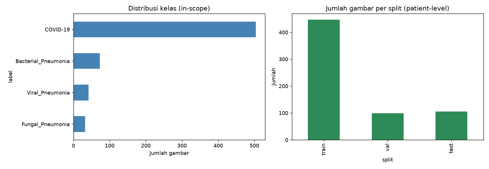
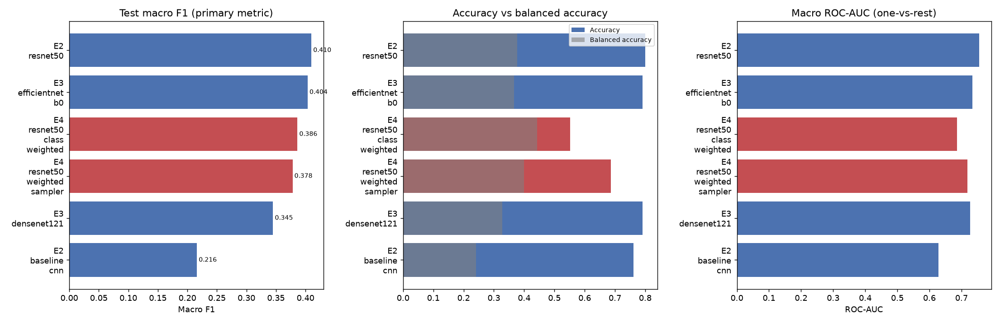
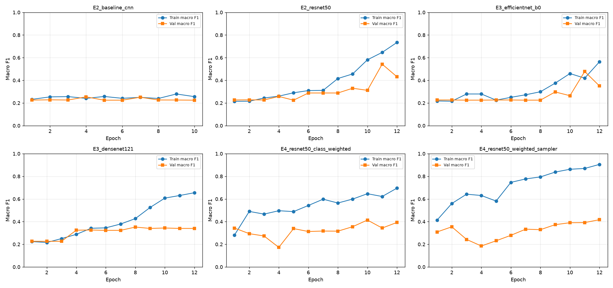
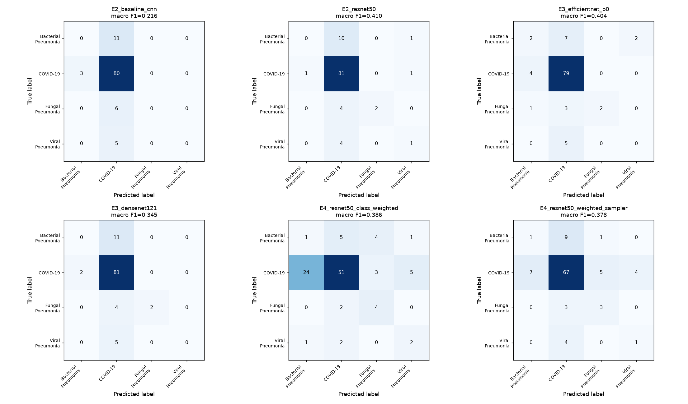
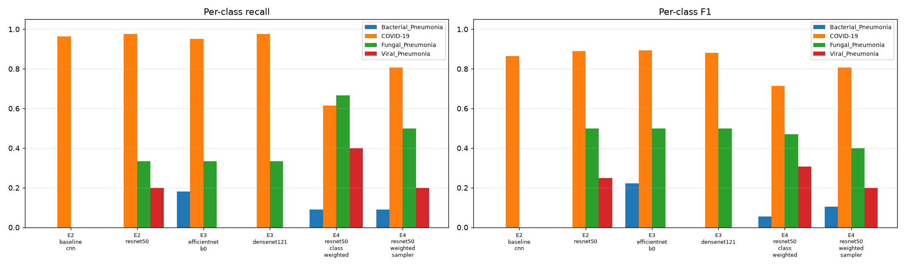

# COVID-19 and Other Pneumonia Etiology Classification in Chest X-ray

**Analysis Report — E1 to E4 (Data Audit, Baseline, Transfer Learning, Class Imbalance)**

> **Disclaimer:** This is a research/technical evaluation, not a clinical diagnostic tool. Model predictions must not be used independently for diagnosis, screening, or treatment. Image interpretation requires a qualified radiologist and clinical context.

## Dataset and scope

- **Source:** `bachrr/covid-chest-xray` (Kaggle), retrieved via its official mirror `ieee8023/covid-chestxray-dataset` (commit `78543292`).
- **Scope adjustment:** the dataset has no `Normal` class or lung masks, so the task was reframed as **four-class pneumonia-etiology classification**: COVID-19, Viral_Pneumonia (non-COVID), Bacterial_Pneumonia, Fungal_Pneumonia.
- **Modality:** X-ray only. **Excluded:** invalid labels (`todo`/`Unknown`), ambiguous unspecified pneumonia/ARDS, and rare categories (Lipoid, TB, Aspiration).

---

## E1. Data Audit and Leakage Prevention

**Objective.** Understand the data, detect duplication, and build leakage-free splits.

**Method.** Labels normalized to four etiology classes; md5 hashing for exact duplicates; difference-hash (Hamming ≤ 2) for near-duplicates; union-find to group related images; stratified **patient-level** train/val/test split.

**Results.**

| Class | Images |
| --- | --- |
| COVID-19 | 504 |
| Bacterial_Pneumonia | 73 |
| Viral_Pneumonia | 42 |
| Fungal_Pneumonia | 32 |

- In-scope images: **651**; patients: **362**; dedup groups: **342**.
- Imbalance ratio (majority:minority): **15.75:1**.
- Exact duplicates: **0**; near-duplicate pairs: **41** (of which **35** cross-patient).
- Split sizes: train=447, val=99, test=105. Patient leakage clean: **True**; dedup-group leakage clean: **True**.

**Description.** The corpus is heavily imbalanced — COVID-19 dominates while Fungal and Viral pneumonia are small. No byte-identical duplicates exist, but cross-patient near-duplicates do, meaning the same image was filed under different patient IDs.

**Interpretation.** With a ~16:1 imbalance, accuracy is misleading: a classifier that always predicts COVID-19 would still reach high accuracy while failing every minority class. Macro F1 and balanced accuracy are therefore the primary metrics. Grouping near-duplicates before splitting prevents the same image from appearing in both train and test, which would otherwise inflate scores.

**Implication.** The imbalance experiment (E4) is essential, and all conclusions rely on minority-class recall rather than raw accuracy.

**Limitations.** Images largely originate from published COVID-19 case reports, introducing selection bias and possible source differences across classes. dHash is heuristic and may miss heavily edited duplicates.

---

## E2–E4. Baseline, Transfer Learning, and Class-Imbalance Handling

**Objective.** Compare a from-scratch CNN against ImageNet transfer learning and test whether class-imbalance handling improves minority-class performance.

**Method.** SmallCNN baseline trained from scratch; ResNet50/EfficientNet-B0/DenseNet121 pretrained on ImageNet with backbone frozen then top blocks fine-tuned. Imbalance strategies: none, class-weighted loss, weighted random sampler. Model selection by validation macro F1; final metrics on the held-out test set.

**Results — overall comparison.**

| Experiment | Model | Imbalance | Acc | Bal_Acc | Macro_F1 | ROC_AUC |
| --- | --- | --- | --- | --- | --- | --- |
| E2_resnet50 | resnet50 | none | 0.8000 | 0.3773 | 0.4100 | 0.7548 |
| E3_efficientnet_b0 | efficientnet_b0 | none | 0.7905 | 0.3667 | 0.4037 | 0.7344 |
| E4_resnet50_class_weighted | resnet50 | class_weighted | 0.5524 | 0.4430 | 0.3864 | 0.6854 |
| E4_resnet50_weighted_sampler | resnet50 | weighted_sampler | 0.6857 | 0.3995 | 0.3781 | 0.7186 |
| E3_densenet121 | densenet121 | none | 0.7905 | 0.3273 | 0.3451 | 0.7276 |
| E2_baseline_cnn | small_cnn | none | 0.7619 | 0.2410 | 0.2162 | 0.6277 |

**Description.**

- **Transfer learning clearly beats the baseline.** ResNet50 reached test macro F1 **0.410** versus the SmallCNN baseline's **0.216**, with balanced accuracy rising from 0.241 to 0.377.
- The baseline's high accuracy (0.762) but very low macro F1 (0.216) shows it largely collapsed onto the majority COVID-19 class.
- Among architectures, ResNet50 (0.410) and EfficientNet-B0 (0.404) outperformed DenseNet121 (0.345).
- **Imbalance handling traded accuracy for minority recall.** Class-weighted ResNet50 reached the **highest balanced accuracy (0.443)** but its accuracy dropped to 0.552 and macro F1 to 0.386; weighted sampling behaved similarly.

**Interpretation.**

Pretrained ImageNet features provide a substantially better starting point than learning from this small, imbalanced corpus from scratch — consistent with the small-data regime. The baseline's accuracy/F1 gap is a textbook illustration of why accuracy is unsafe under imbalance. Class-weighting and balanced sampling increase minority-class recall (raising balanced accuracy) by pushing the decision boundary away from the majority class, but on this dataset that shift also increases false positives among minority classes, so overall macro F1 and accuracy decline. In other words, imbalance handling redistributes errors rather than eliminating them here.

**Per-class behavior.**

| Experiment | recall_Bacterial_Pneumonia | recall_COVID-19 | recall_Fungal_Pneumonia | recall_Viral_Pneumonia |
| --- | --- | --- | --- | --- |
| E2_baseline_cnn | 0.0000 | 0.9640 | 0.0000 | 0.0000 |
| E2_resnet50 | 0.0000 | 0.9760 | 0.3330 | 0.2000 |
| E3_efficientnet_b0 | 0.1820 | 0.9520 | 0.3330 | 0.0000 |
| E3_densenet121 | 0.0000 | 0.9760 | 0.3330 | 0.0000 |
| E4_resnet50_class_weighted | 0.0910 | 0.6140 | 0.6670 | 0.4000 |
| E4_resnet50_weighted_sampler | 0.0910 | 0.8070 | 0.5000 | 0.2000 |

Plain ResNet50 retains strong COVID-19 recall (0.976) but weaker minority recall; class-weighting lifts minority recall (e.g., Fungal 0.333 → 0.667, Bacterial 0.000 → 0.091) at the cost of COVID-19 recall (0.976 → 0.614).

**Implication.** For balanced multi-etiology discrimination, the plain ResNet50 currently offers the best macro F1, while the class-weighted variant is preferable if minority-class sensitivity is the priority. This is a deliberate accuracy-versus-sensitivity trade-off, not a free win.

**Limitations.** Training ran on CPU without a GPU, so epoch counts were capped; results indicate relative trends, not maximal performance. The test set is small (105 images), so differences between models should be read with bootstrap confidence intervals. Findings are exploratory and not clinically validated.

---

## Summary of findings (E1–E4)

1. The dataset is small and strongly imbalanced (~16:1), so accuracy alone is unreliable.
2. Transfer learning substantially outperforms a from-scratch baseline (macro F1 0.410 vs 0.216).
3. ResNet50 is the strongest architecture tested (macro F1 0.410).
4. Imbalance handling raises balanced accuracy (up to 0.443) but lowers overall accuracy and macro F1 — a sensitivity/specificity trade-off.

**Next steps (E5–E8, to be continued):** center-crop ablation, robustness testing, Grad-CAM explainability, confidence calibration, and bootstrap confidence intervals on the selected model.
